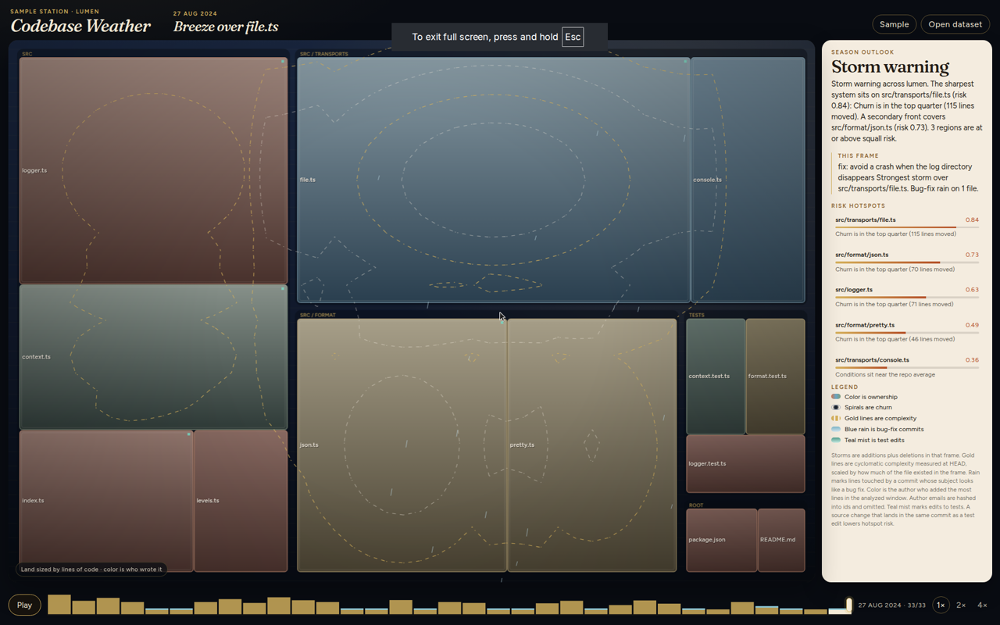
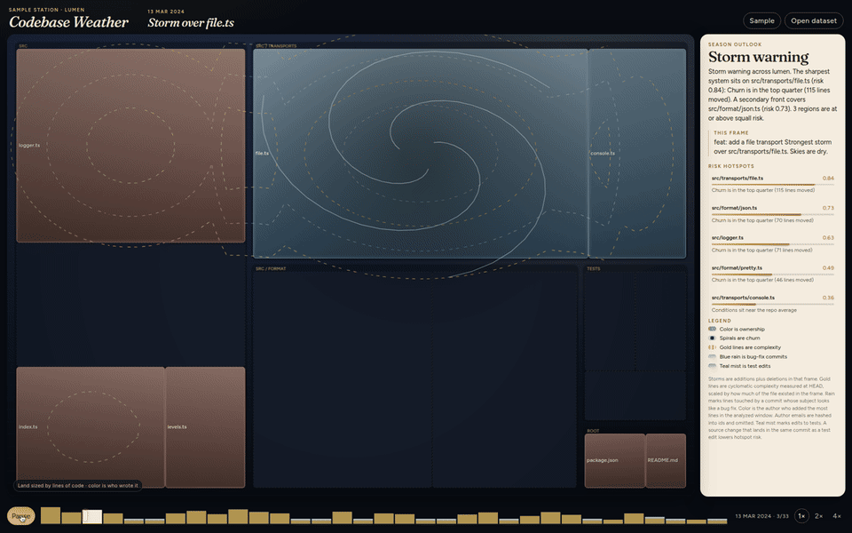
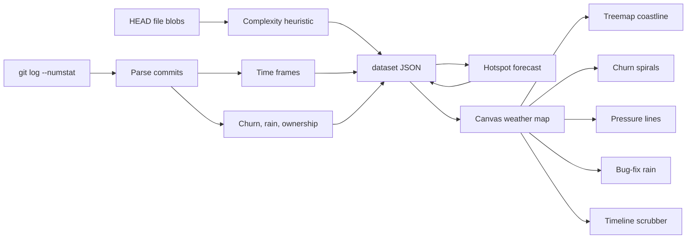

# Codebase Weather

Git history, drawn as a forecast. The file tree is a coastline, churn is a storm, cyclomatic complexity is a pressure field, bug-fix commits fall as rain, and the author who wrote a file holds its territory. A timeline plays the repository the way a forecast plays a week.

The sample station is **lumen**, a small fictional logger with 33 commits from March to August 2024. The dataset is produced by the analyzer, so the map is measuring real diffs, not a hand-drawn illustration.

[](https://github.com/ataperata/codebase-weather/actions/workflows/ci.yml)





## Quickstart

```bash
npm install
npm test
npm run dev
```

Open the dev server. The sample dataset is already in `web/public/demo.json`, so the map loads with no extra step.

Regenerate that dataset after changing the analyzer:

```bash
npm run demo
```

Analyze any local repository:

```bash
npm run analyze -- --repo /path/to/repo --out weather.json
```

Then use **Open dataset** in the map. Author emails are hashed into ids and are not written to the JSON. The repository path is omitted too.

Build the static site:

```bash
npm run build
npm run preview
```

`npm run build` writes `web/dist`.

## How to read the map

| Weather | Measurement |
| --- | --- |
| Coastline | File tree, laid out as a squarified treemap. Area is lines of code. Directory islands stay put while history plays. |
| Color | Ownership. The author who added the most lines in the analyzed window. |
| Spirals | Churn, additions plus deletions in the frame. Strength is compared with the windiest moment in the window, so a two-line fix stays a breeze. |
| Gold lines | Cyclomatic pressure. Decision points measured on the file at HEAD, scaled by how much of that file existed in the frame. |
| Blue rain | Lines touched by a commit whose subject looks like a fix, bug, hotfix, or regression. |
| Teal mist | Edits under `test`/`spec` paths. A source change that lands in the same commit lowers hotspot risk. |

Keyboard: Space plays and pauses, Left and Right scrub, Home and End jump.

The briefing on the right is the season outlook: a risk score and a short forecast for the sharpest systems. The ribbon above the map is the current frame.

Risk for a file is

`0.34·churn + 0.28·complexity + 0.22·bug-fixes + 0.16·ownership split − 0.12·test relief`

each term a percentile or a normalized share, clamped to 0–1. On lumen that puts `src/transports/file.ts` under a storm warning and `src/format/json.ts` on the next front.

## Architecture



```
analyzer/     git history to JSON, plus the lumen sample builder
web/          Vite + TypeScript canvas map
web/public/demo.json
```

The analyzer shells out to git. One `git log --numstat` pass collects the window (default: the most recent 500 commits), then `git cat-file --batch` reads HEAD blobs for complexity. Frames are weekly when the history is long, and one commit each when it is short. Files beyond `--max-files` (default 600) are dropped by a churn-and-size score and counted as omitted.

Complexity is a heuristic: comments and strings are stripped, then `if` / `for` / `while` / `case`, `&&` / `||`, and real ternaries each add one. It is not an AST and it is not a historical reconstruction. The README in the briefing says the same thing in the metric notes stored on the dataset.

## Deploy

The site is a static Vite build. `vercel.json` at the repo root sets:

- install: `npm ci`
- build: `npm run build`
- output: `web/dist`

No environment variables. Import the repo in Vercel with those settings, or rely on the file. This project does not create or modify a hosted Vercel project on its own.

## Tests

```bash
npm test
npm run typecheck
npm run build
```

CI runs those, regenerates `web/public/demo.json`, and fails if the committed sample drifted. The analyzer tests cover the complexity heuristic, git-log parsing, the risk formula, and a real git repository built by the sample writer. The web tests cover the treemap and the forecast wording.

## License

MIT. See [LICENSE](LICENSE).
